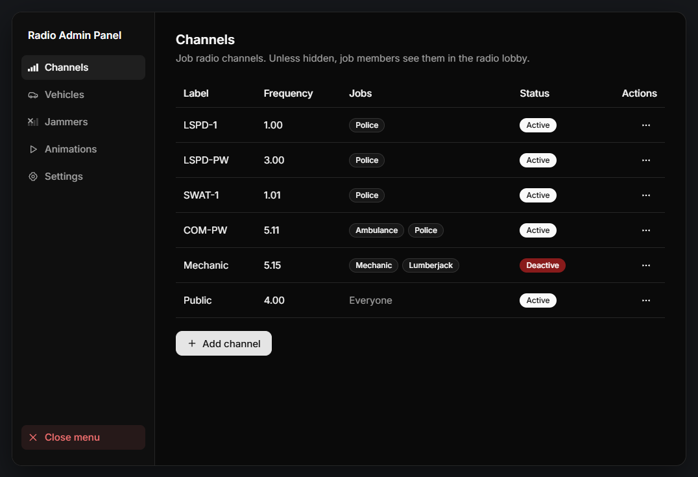
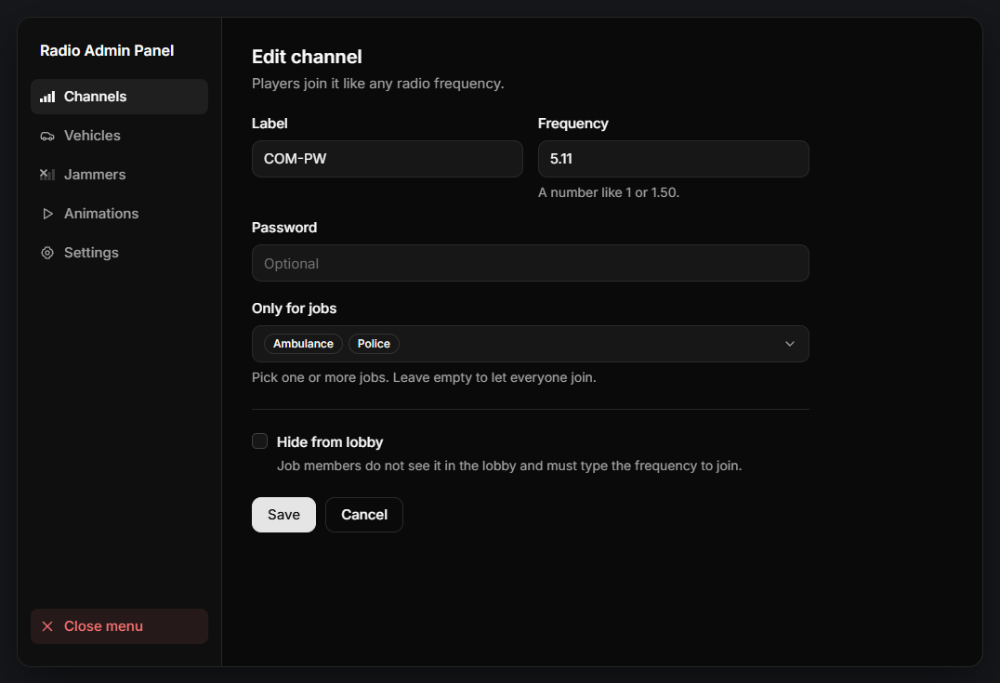
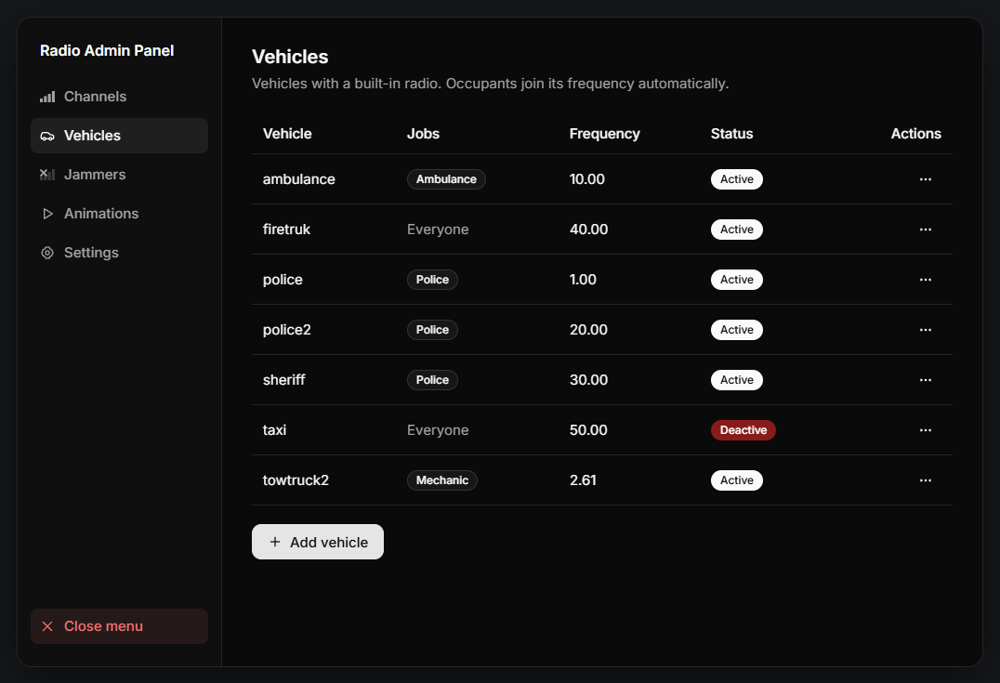
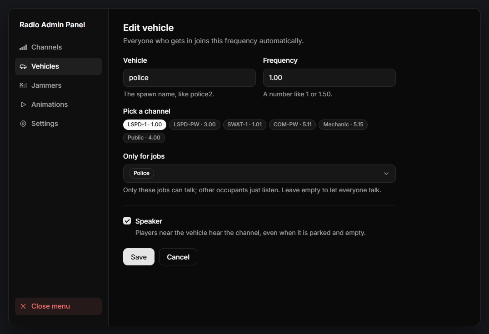
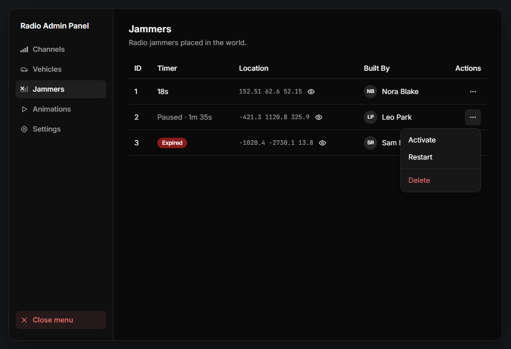
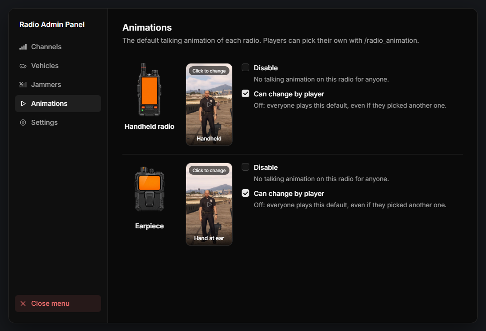
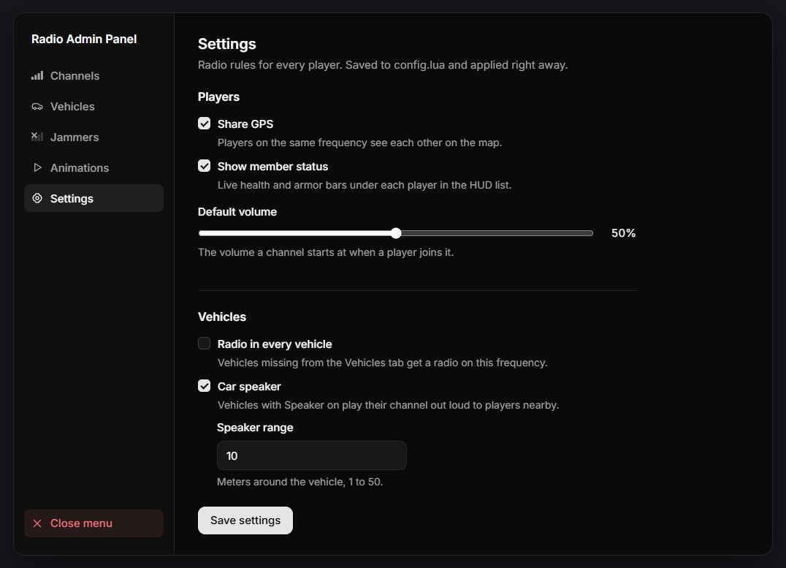

# Admin Panel

Open the panel with the `/radioadmin` command.

Everything you change here is saved to `config.lua` and applied to all players right away. No restart is needed.


The panel is available to players with the `command` ace, or with one of the groups in `Config.AdminGroups`.


### Channels

This is the list of your job channels. Job members see these channels in the radio lobby, under **Job Frequency**.

<figure><figcaption></figcaption></figure>

Click **Add channel** to create a new one, or use the **Actions** menu of a channel to edit, deactivate or delete it. Delete asks for a second click to confirm.

<figure><figcaption></figcaption></figure>

* **Label:** The name shown in the lobby.
* **Frequency:** A number like 1 or 1.50. Two channels cannot use the same frequency.
* **Password:** Optional. Players must enter it to join.
* **Only for jobs:** Pick one or more jobs. Leave it empty to let everyone join.
* **Hide from lobby:** Job members do not see the channel in the lobby and must type the frequency to join.

### Vehicles

This is the list of vehicles with a built-in radio. Everyone who gets in the vehicle joins its frequency automatically.

<figure><figcaption></figcaption></figure>

Click **Add vehicle** to give a vehicle a radio, or use the **Actions** menu to edit, deactivate or delete it.

<figure><figcaption></figcaption></figure>

* **Vehicle:** The spawn name, like `police2`.
* **Frequency:** A number like 1 or 1.50. Several vehicles can share one frequency.
* **Pick a channel:** Click one of your job channels to fill in its frequency and jobs.
* **Only for jobs:** Only these jobs can talk. Other occupants just listen. Leave it empty to let everyone talk.
* **Speaker:** Players near the vehicle hear the channel, even when it is parked and empty.

### Jammers

This is the list of every radio jammer placed in the world, with its timer, location and the player who placed it.

<figure><figcaption></figcaption></figure>

* **Eye icon:** Teleports you next to the jammer.
* **Deactivate:** Pauses the timer and stops the jamming.
* **Activate:** Resumes the timer.
* **Restart:** Runs the full timer again.
* **Delete:** Removes the jammer and its prop. It asks for a second click to confirm.

### Animations

Here you set the default talking animation of each radio. Click the card to choose another one.

<figure><figcaption></figcaption></figure>

* **Disable:** No talking animation on this radio for anyone.
* **Can change by player:** Players can pick their own animation with `/radio_animation`. When it is off, everyone plays the default.

### Settings

These are the radio rules for every player. Click **Save settings** to apply them.

<figure><figcaption></figcaption></figure>

* **Share GPS:** Players on the same frequency see each other on the map.
* **Show member status:** Live health and armor bars under each player in the HUD list.
* **Default volume:** The volume a channel starts at when a player joins it.
* **Radio in every vehicle:** Vehicles missing from the Vehicles tab get a radio on the frequency you enter.
* **Car speaker:** Vehicles with Speaker on play their channel out loud to players nearby.
* **Speaker range:** Meters around the vehicle, 1 to 50.
