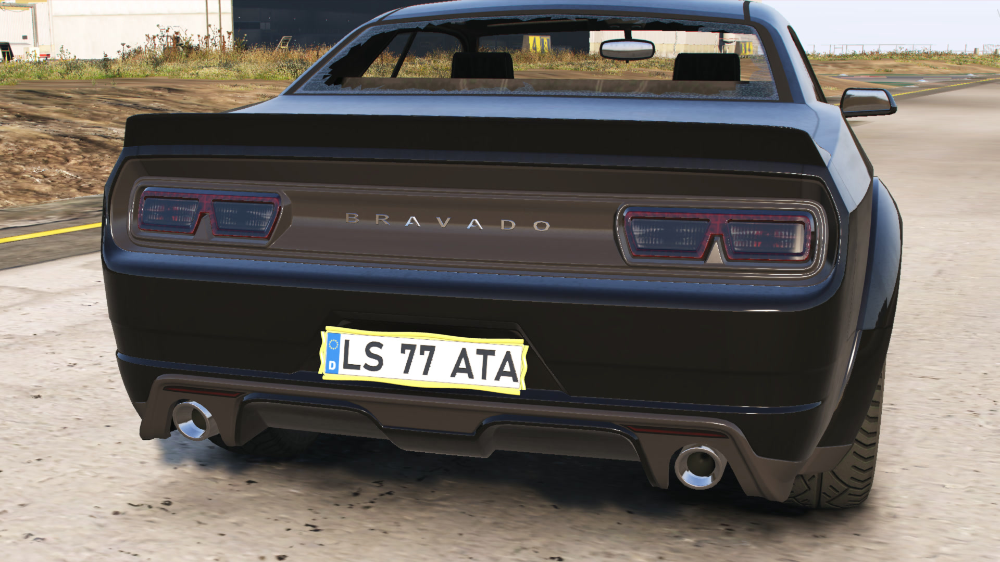
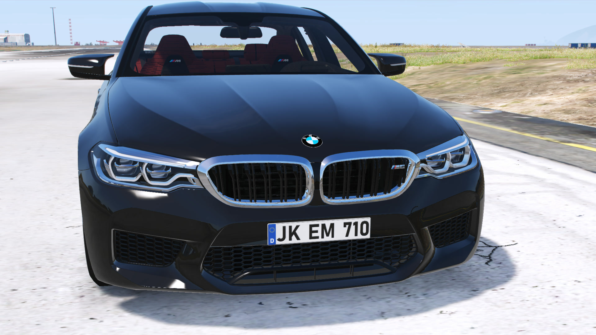
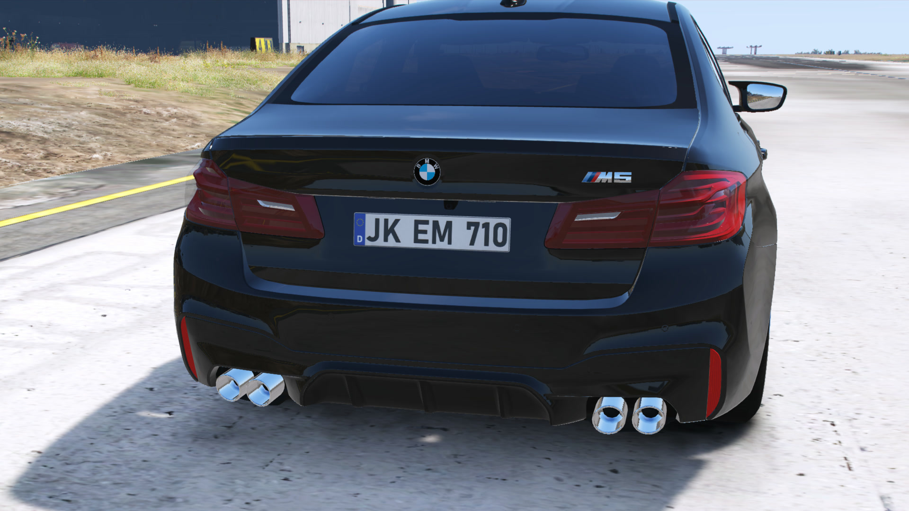
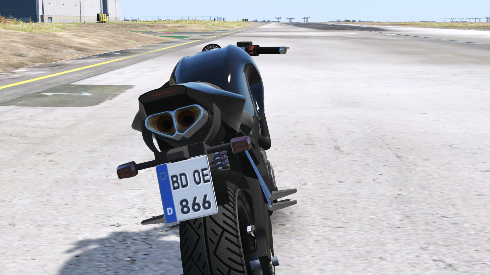

# 🪪 Custom License Plates

real country license plates for FiveM

plate shop, a full plate designer, 60 plate holders, a plate flipper and an admin panel that runs all of it in game

***

note: this software is protected by DMCA, selling or sharing it is illegal

## what you get

* 46 countries with their real plate shape, font and format (EU, UK, US, Saudi Arabia, Israel, Iran, Turkey, China and a lot more)
* plates are real 3D props on the car, not a texture swap, so every car model works
* a plate shop with random plates, catalog plates and custom plates
* a plate designer with ready made designs, stickers, animated gifs, fonts and backgrounds
* 60 plate holders, each one fits every plate size
* plate flipper item, flips the plate so nobody can read it
* admin panel for plates, catalog, prices, logs and settings, no restart needed
* discord logs with the plate as a picture
* exports for MDT, radar and police scripts

## works with your server

you dont need to change your garage, inventory or key script, everything is picked up by itself

|           | supported                                                           |
| --------- | ------------------------------------------------------------------- |
| framework | ESX, QBCore, Qbox, standalone                                       |
| target    | ox\_target, qb-target, or a simple key press                        |
| garage    | any garage that reads the plate from the database, see How It Works |

### inventories, all tested

* ox\_inventory
* qs-inventory
* codem-inventory
* qb-inventory
* ps-inventory
* lj-inventory
* jpr-inventory
* ESX inventory

running a different inventory? you can make it work yourself, open `bridge/server.lua`, copy one of the inventory parts and change the export names, see [Editable Files](editable-files.md)

### key systems, all tested and synced

the keys move to the new plate the moment it goes on the car, for the owner and for the player who fit it, and they come back when the plate comes off

* qbx\_vehiclekeys
* wasabi\_carlock
* qs-vehiclekeys
* vehicles\_keys
* ak47\_vehiclekeys
* MrNewbVehicleKeys
* qb-vehiclekeys
* Renewed-Vehiclekeys
* cd\_garage

key items in ox\_inventory (vehiclekey, carkey and so on) get the new plate too

your key script isnt on the list? same thing, its about 3 lines in `bridge/server.lua`

## add-on cars, automatic

you dont set up anything per car

when the script starts, the server checks every car that is streamed on your server, finds where its plates are, hides the old plate and saves it all in a cache

this runs once, after that every restart only checks cars you added since last time, nothing new? nothing to check

front and rear plates both work, fully synced for every player

## bikes

bikes get their own plate size for each country, the real bike plate, not a squeezed car plate

## commands

| command     | who      | what                                        |
| ----------- | -------- | ------------------------------------------- |
| /plateshop  | everyone | opens the shop (can be turned off)          |
| /plateflip  | everyone | flips the plate if the car has a flipper    |
| /plateadmin | admins   | opens the admin panel                       |
| /platefix   | admins   | moves the plate of one car model into place |
