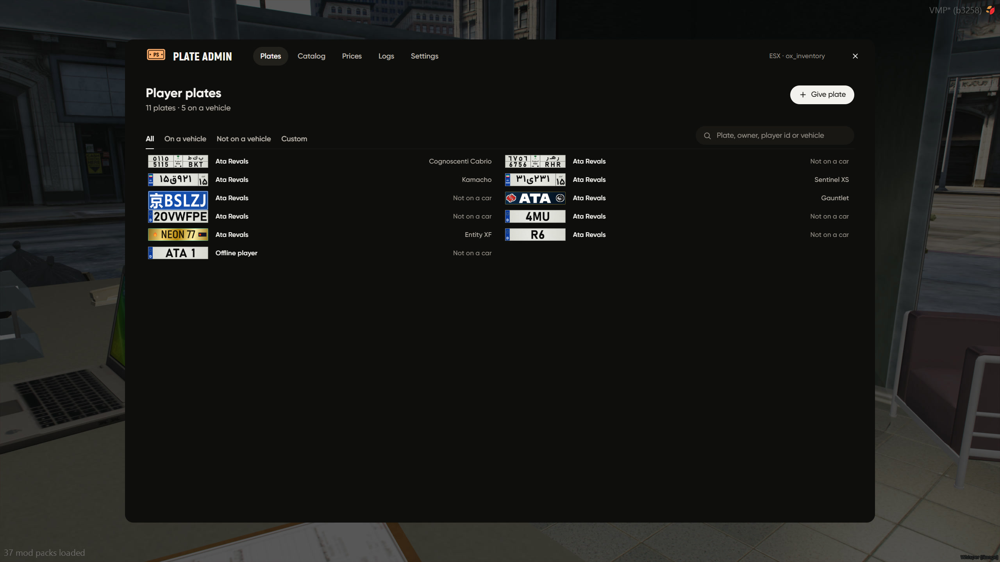
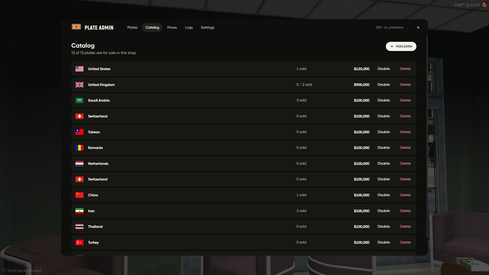
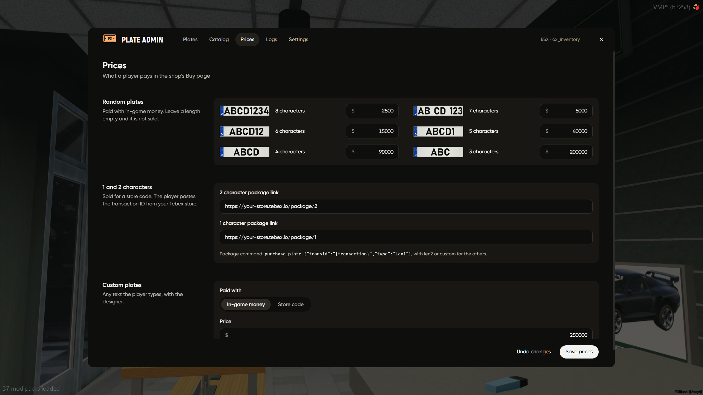
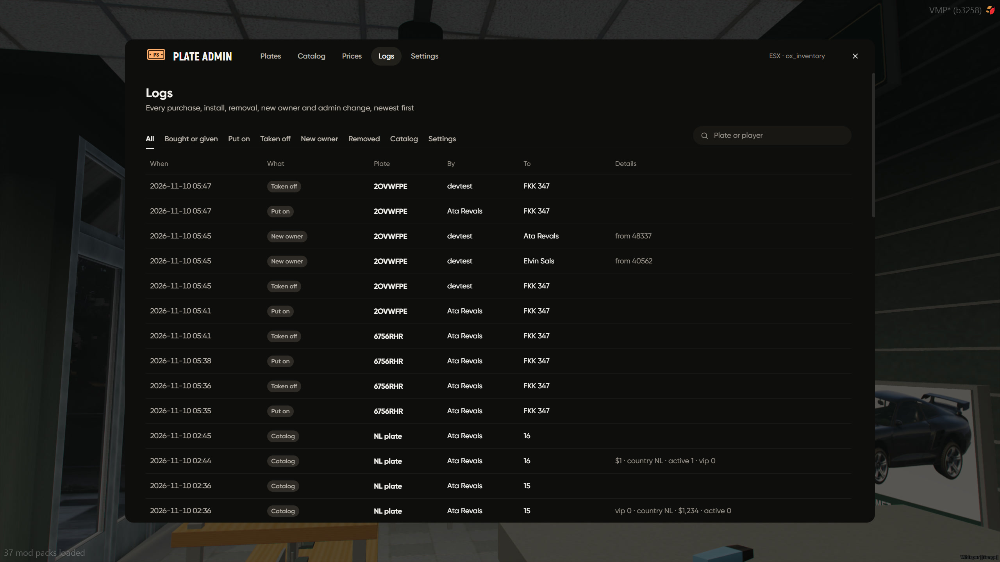
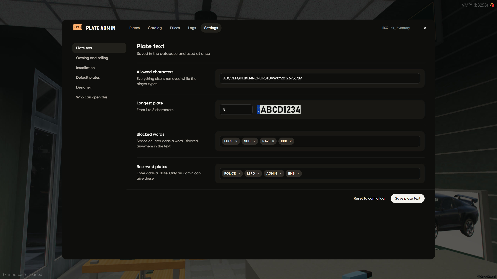

# Admin Panel

`/plateadmin` opens it, for groups in `Config.Shop.adminGroups` or anyone with the ace `ata_vehicleplate.admin`

everything you change here is saved in the database and works right away, no restart

## plates

every player plate, who owns it and which car its on, search by plate, owner, player id or vehicle

click a plate to give it to someone else, take it off a car or delete it, **Give plate** hands out any plate

## catalog

plates for sale in the shop

**Add plate** lets you pick the country, a design from the editor, the price, stock and VIP

"my own rules" sets a fixed start (like `AT`), letters, numbers or both, and which lengths players can buy

## prices

random plate price per length, tebex links for 1 and 2 character plates, and the custom plate price

## logs

every purchase, install, removal, new owner and admin change, newest first

## settings

| area               | what                                                              |
| ------------------ | ----------------------------------------------------------------- |
| Plate text         | allowed characters, longest plate, blocked words, reserved plates |
| Owning and selling | max plates per player, sell refund, transfers                     |
| Installation       | install method, distance, owned cars only, item prices            |
| Default plates     | server country, formats, see [Country Plates](country-plates.md)  |
| Designer           | design limits                                                     |
| Who can open this  | admin groups                                                      |

**Reset to config.lua** puts a section back to what your config says

## /platefix

an add-on car has its plate in the wrong spot? stand next to it, type `/platefix` and move the plate into place, saved for that model for everyone
