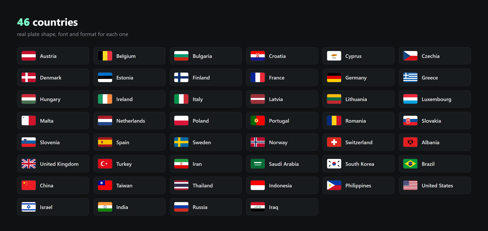
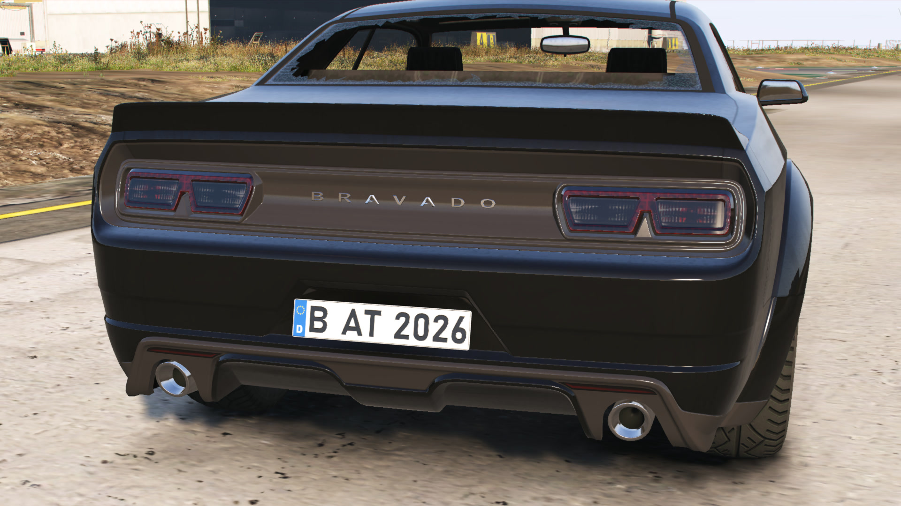
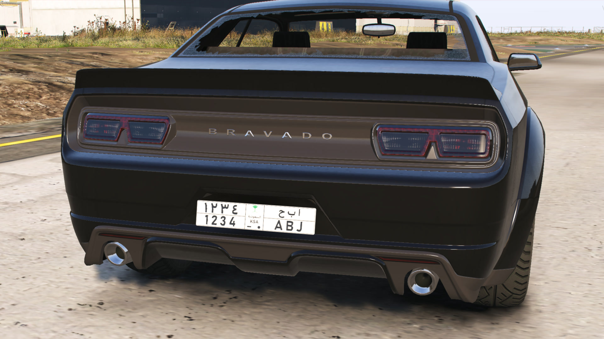
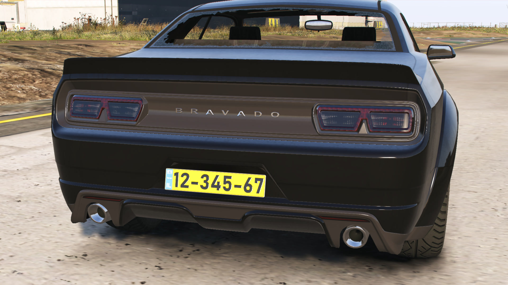
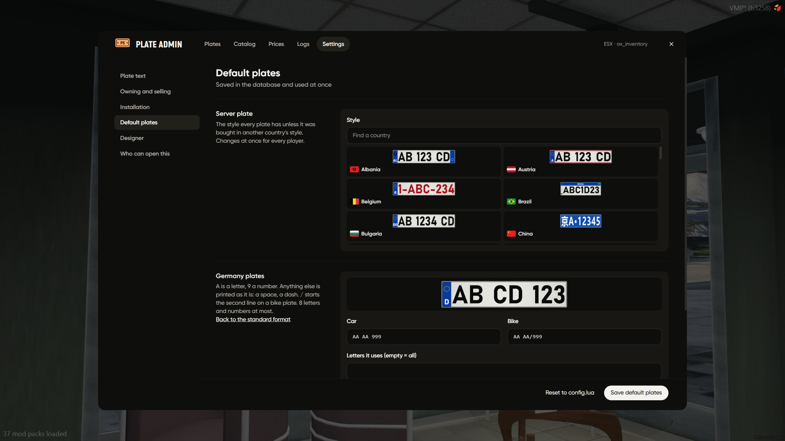

# Country Plates

46 countries, each with its real shape, font, colours and format, for cars and bikes

your server picks one style, every new car gets a random plate in that format



## europe, germany



```lua
Config.Country = 'DE'
DE = { car = 'AA AA 999', bike = 'AA AA/999' }
```

## saudi arabia



arabic and latin on the same plate, both drawn from the one plate text

```lua
SA = { car = '9999|AAA', bike = '9999/AAA', letters = 'ABJDRSXTEGKLZNHUV', strict = true }
```

saudi has a long and a short plate, the player picks one in the shop

## israel



```lua
IL = { car = '99-999-99', bike = '999/99-99', strict = true }
```

## how the format works

| sign | means                     |
| ---- | ------------------------- |
| `A`  | a letter                  |
| `9`  | a number                  |
| `\|` | the divider (saudi, iran) |
| `/`  | second line, for bikes    |

* `letters` only these letters are used
* `strict = true` bought plates have to follow the format too
* GTA keeps 8 characters max

## change it in game

`/plateadmin` → Settings → Default plates

pick the server style, change any countrys car and bike format and its letters, save, done, no restart


