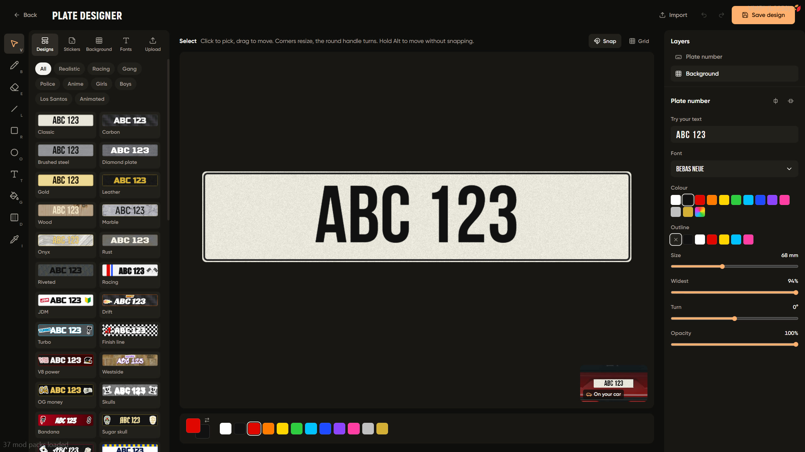

# Editor

a full plate designer inside the shop, players make their own plate and see it on their car right away



## left: tools

select, brush, eraser, line, box, circle, text, fill and colour picker, each one has a key (V B E L R O T G I)

## library

* **Designs** ready made plates: realistic, racing, gang, police, anime, girls, boys, los santos, animated
* **Stickers** normal and animated stickers
* **Background** colours and textures (carbon, wood, marble, gold ...)
* **Fonts** plate fonts
* **Upload** your own picture or gif

## right: layers

every sticker and text is its own layer, pick one to move, resize or turn it

**Plate number** is the real plate text, change its font, colour, outline, size, width, angle and opacity, the text itself always comes from the plate

## top

* **Import** paste a 6 character share code to load someone elses design
* undo and redo
* **Save design** saves it to your account

bottom right shows the design on a car

## limits

in `/plateadmin` → Settings → Designer

```lua
designs = { maxPerPlayer = 30, maxKB = 2500, gifMaxKB = 1500 }
```
