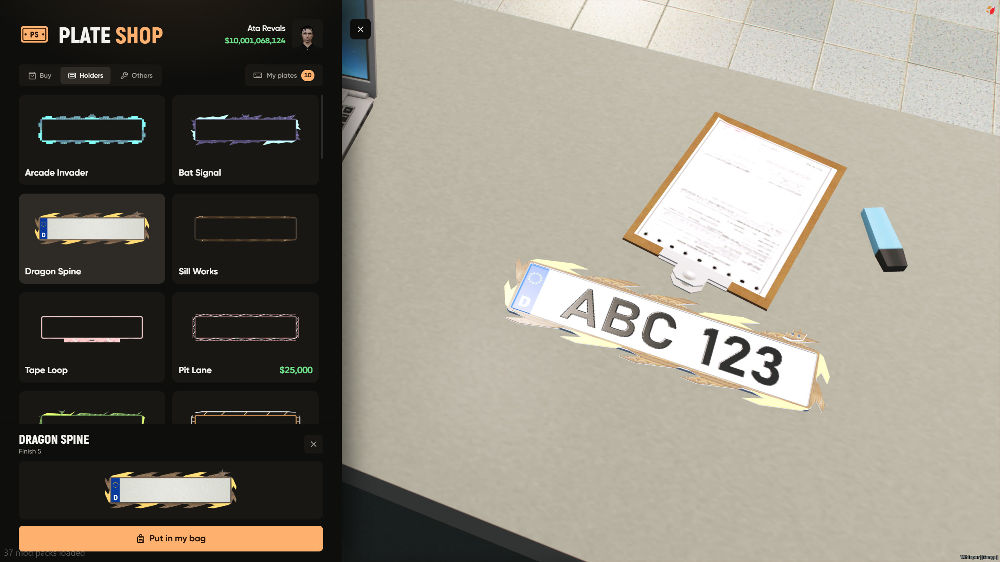
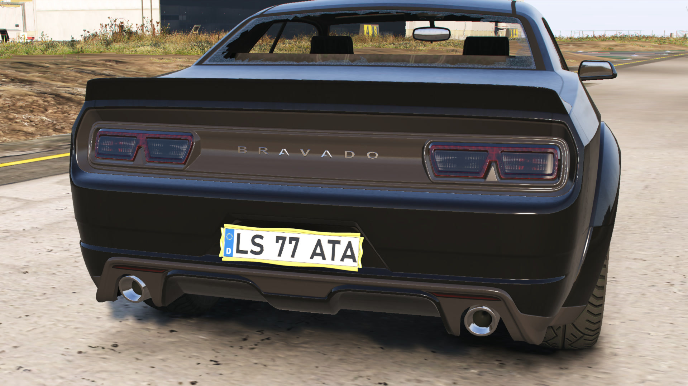

# Holders

60 plate holders with 5 finishes each (two of them have 10)

every holder fits every plate size, the script picks the right one for the car by itself, some have moving parts





## how players get one

1. buy it in the shop under **Holders**
2. its an item now, use it next to your car
3. a screwdriver takes it off again

with the ESX inventory (no metadata) the holder goes on from the shop instead

## price

`/plateadmin` → Settings → Installation, or in config

```lua
holder = { item = 'plate_holder', price = 25000 },
```

## from other scripts

```lua
exports.ata_VehiclePlate:SetVehiclePlateHolder(vehicle, style, finish)  -- style 1-60, nil removes it
```
