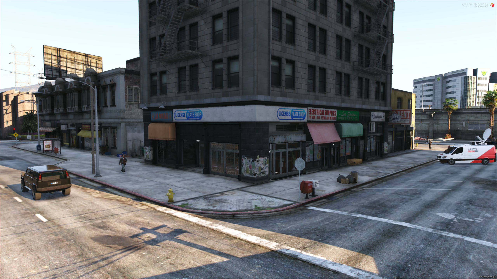
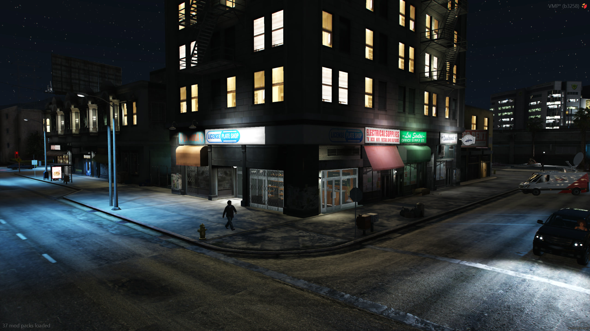
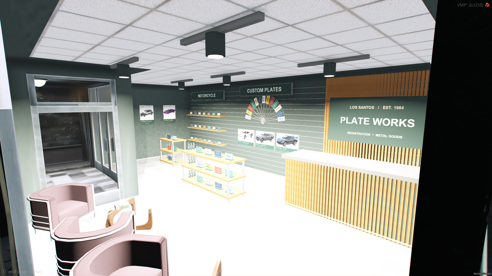
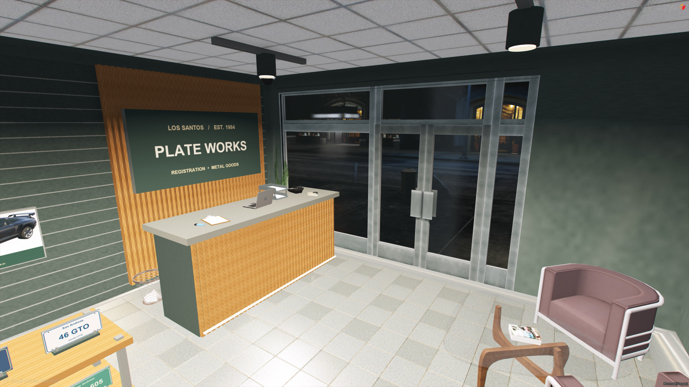
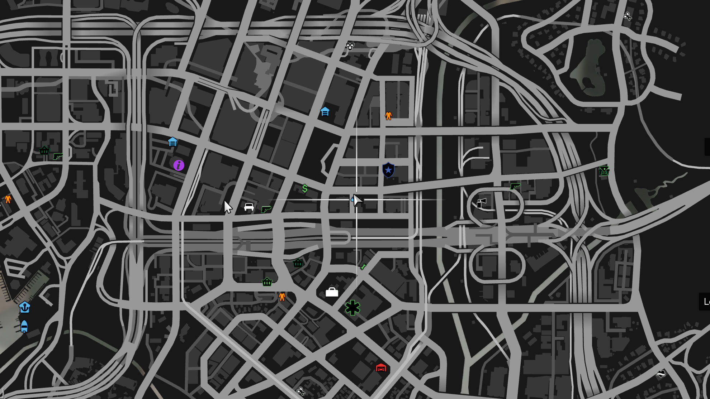

# MLO

the plate shop building, with the counter where the picked plate shows up on the table

|          |                                    |
| -------- | ---------------------------------- |
| location | Mission Row, downtown Los Santos   |
| coords   | `vector3(319.95, -1075.70, 29.48)` |
| size     | 13 MB                              |
| resource | `ata_vehicleplatestore_MLO`        |

```
ensure ata_vehicleplatestore_MLO
```

the default shop location in `config.lua` is already inside it, nothing to move

## outside

a corner shop, open from both streets





## inside





## on the map


