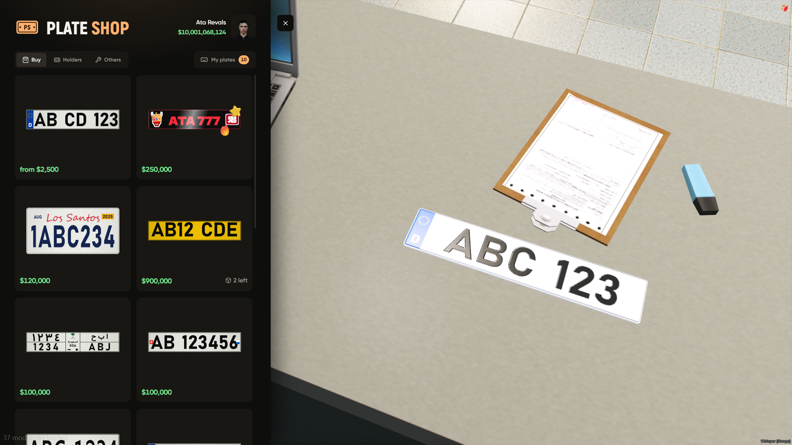
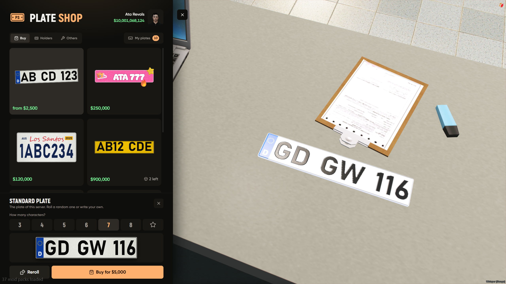
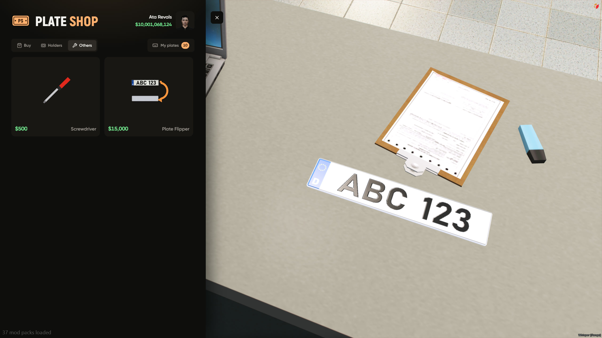
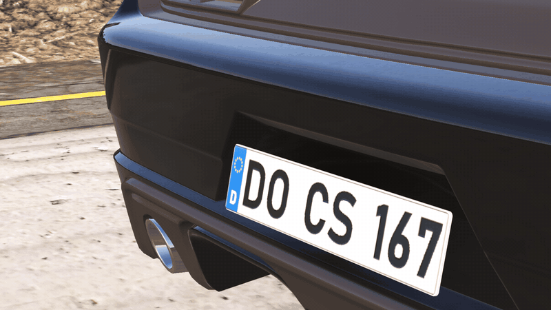
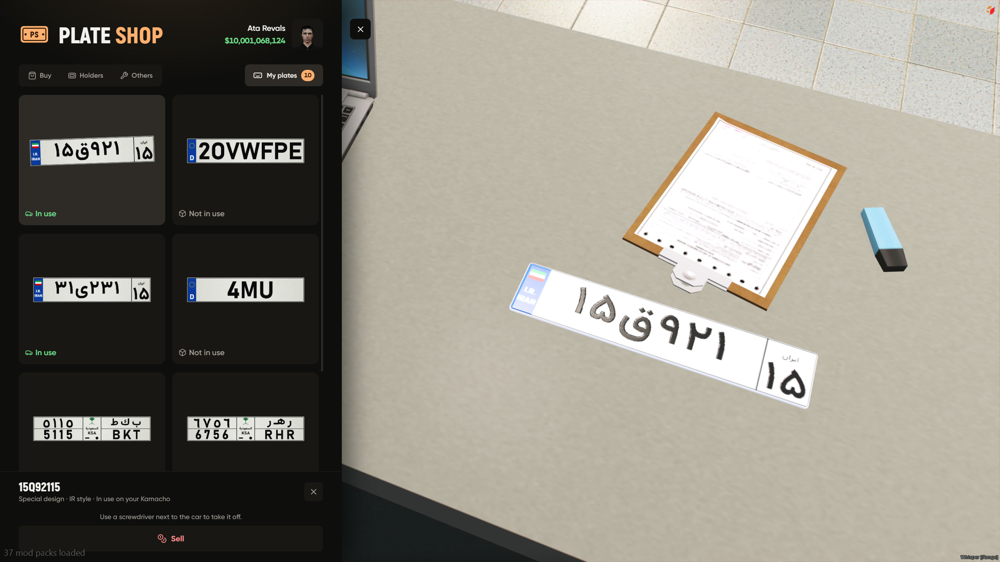

# Shop

walk up to the counter or type `/plateshop`, the plate you pick shows up on the table in front of you

the table plate is only on your screen, players next to you dont see it



## buy

* **standard plate** a random plate in your servers format, shorter plates cost more, reroll till you like it or type your own
* **catalog plates** plates the admin puts up for sale, with a design, a price, stock and VIP
* **custom plate** any text, any design from the editor, paid with in game money or a tebex code



the player picks cash or bank when they pay

## holders

every holder with its finishes, see [Holders](holders.md)

## others

* **screwdriver** takes plates and holders off a car
* **plate flipper** fit it once, then `/plateflip` turns the plate so nobody can read it





## my plates

all your plates, which car theyre on, and what you can do with them

* put it on your car or take it off
* put it in your bag as an item, give it or trade it
* open its design in the editor
* sell it back (half the price by default)
* right click to get a share code for the design



## putting plates on

```lua
installMethod = 'auto'   -- auto | item | shop
```

* **item** the plate is an item, use it next to your car
* **shop** put it on from My plates while standing near the car
* **auto** item if your inventory supports metadata, shop if not
